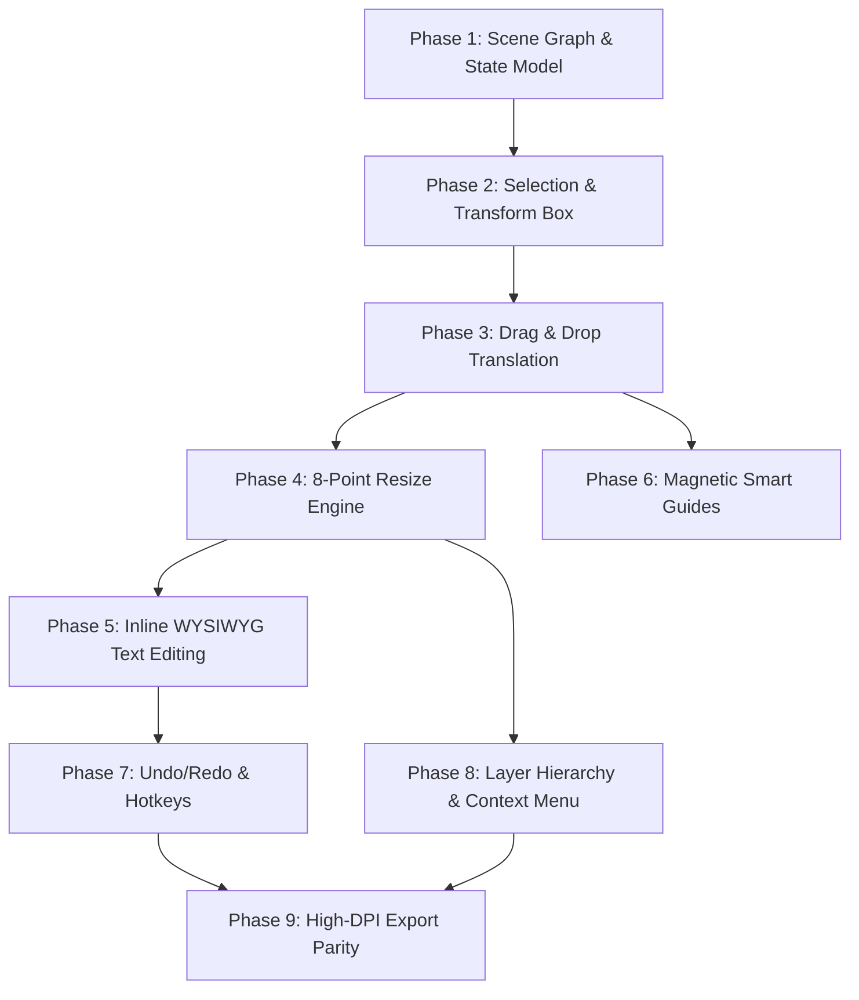

# Advanced In-App Canvas Editor: Step-by-Step Implementation Blueprint (`adv_editor.md`)

> **Product:** KontentOS Static Post Studio  
> **Target:** In-App Canva-like Direct Manipulation Visual Editor (Drag, Drop, Select, Resize, Inline Edit, Snap, Layers, History)  
> **Execution Strategy:** Modular, zero-regression roadmap partitioned into granular sub-tasks where **each sub-task is strictly scoped for safe single-prompt implementation**.

---

## 1. Architectural Strategy & Design Principles

### 1.1 The Hybrid Scene Graph Model
KontentOS currently renders static posts via responsive CSS layout components ([InstagramOverlayCard.tsx](file:///d:/Abu%20Horairah%20Ansari/Internship_Projects/KontentOS%20v3/KontentOS-App/src/screens/StaticGenerator/components/formats/InstagramOverlayCard.tsx), [LinkedInSplitCard.tsx](file:///d:/Abu%20Horairah%20Ansari/Internship_Projects/KontentOS%20v3/KontentOS-App/src/screens/StaticGenerator/components/formats/LinkedInSplitCard.tsx), etc.) driven by [StaticCardState](file:///d:/Abu%20Horairah%20Ansari/Internship_Projects/KontentOS%20v3/KontentOS-App/src/types/staticCard.ts). 

Rather than discarding the existing curated themes, typography engines, and AI generation, we implement a **Hybrid Scene Graph**:
1. **Default Flow Mode (Existing):** Formats arrange elements semantically using Flexbox/Grid according to format archetypes.
2. **Free-Transform Layer (Canva Mode):** Each visual element (Headline, Body Text, Author Profile Badge, Accent Tag, Media Container, Watermark) is assigned a stable layer ID and an optional coordinate transform override `{ x, y, width, height, rotation, zIndex }`.
3. **Non-Destructive Overrides:** If an element has never been dragged or resized, it adheres to the responsive layout. As soon as the user drags or resizes it, its relative percentages/pixel coordinates are stored in the active slide's layer map.
4. **Export WYSIWYG Parity:** High-resolution PNG and PDF exports render the identical transformed DOM tree with transform overlays stripped.

### 1.2 Core Guarantees for Single-Prompt Safety
Every sub-task specified in this roadmap satisfies four strict safety conditions:
- **Zero Breaking Changes:** Existing AI copy generation, deck generation, theme switching, and export buttons continue working without interruption.
- **Isolated File Footprint:** Edits are localized to new modular components or clean extension hooks before touching canvas cores.
- **Immediate Visual & Runtime Testability:** Every task concludes with a concrete verification checklist and `tsc --noEmit` validation.
- **Bounded Scope:** No single prompt touches more than 2–3 related files or exceeds ~300 lines of net change.

---

## 2. Current State vs. Target State

| Dimension | Current State | Target Canva-Grade State |
| :--- | :--- | :--- |
| **Element Selection** | Static preview only; no hover/selection outlines. | Click to select element with bounding box & 8 control handles. |
| **Positioning** | Fixed CSS Flexbox / Grid per template layout. | Free pointer drag & drop with bounding clamp & arrow key nudges. |
| **Sizing** | Predetermined by content length and font scale slider. | Multi-directional 8-point interactive resize handles + text reflow. |
| **Text Editing** | Left-hand sidebar textareas only. | Double-click canvas inline editing with live sync to state. |
| **Alignment Guides** | Static 3x3 rule-of-thirds grid overlay. | Magnetic smart guides (center-X, center-Y, element-to-element snaps). |
| **History & Undo** | No canvas-specific undo/redo. | Full snapshot history stack (Undo: `Ctrl+Z`, Redo: `Ctrl+Y`). |
| **Layer Stacking** | Fixed DOM ordering in template JSX. | Z-index manipulation (Bring to Front, Send to Back, Lock, Hide). |
| **Export Fidelity** | Captured via `html-to-image` from fixed DOM layout. | Captured with zero-artifact custom coordinates & pixel-perfect DPI. |

---

## 3. Phased Roadmap & Single-Prompt Sub-Task Matrix



---

### Phase 1: Scene Graph Data Model & State Architecture
*Foundational types and coordinate mapping that allow elements to store custom positions without breaking template rendering.*

#### Task 1.1: Element Scene Graph & Transform Type Definitions
- **Intent:** Define clean, extensible TypeScript interfaces for element coordinates, layer IDs, and transform states.
- **Files to Touch/Create:**
  - Create: `KontentOS-App/src/types/canvasScene.ts`
  - Modify: `KontentOS-App/src/types/staticCard.ts` (re-export or import reference)
- **Detailed Scope:**
  - Define `CanvasElementId`: `'headline' | 'body' | 'profile' | 'badge' | 'media-box' | 'watermark' | string`.
  - Define `ElementTransform`:
    ```ts
    export interface ElementTransform {
      id: CanvasElementId;
      x: number; // percentage (0-100) or pixels
      y: number; // percentage (0-100) or pixels
      width?: number; // percentage or px
      height?: number; // percentage or px
      rotation?: number; // degrees (-180 to 180)
      zIndex: number;
      isLocked?: boolean;
      isHidden?: boolean;
      customStyle?: Record<string, string | number>;
    }
    ```
  - Define `SlideSceneState`: `Record<CanvasElementId, ElementTransform>`.
  - Add optional `sceneOverrides?: Record<number, SlideSceneState>` to `StaticCardState`.
- **Single-Prompt Verification:**
  - Run `npx tsc --noEmit`. Must pass with 0 errors.
  - No runtime components modified yet; zero regression risk.

#### Task 1.2: Canvas Interaction Zustand/React Hook
- **Intent:** Provide a lightweight state manager for active selection, drag status, and hover highlights.
- **Files to Touch/Create:**
  - Create: `KontentOS-App/src/screens/StaticGenerator/hooks/useCanvasInteraction.ts`
- **Detailed Scope:**
  - Track:
    - `selectedElementId: CanvasElementId | null`
    - `hoveredElementId: CanvasElementId | null`
    - `isDragging: boolean`
    - `isResizing: boolean`
    - `activeHandle: 'nw' | 'n' | 'ne' | 'e' | 'se' | 's' | 'sw' | 'w' | 'rot' | null`
    - `editingElementId: CanvasElementId | null` (for inline text edit)
  - Actions: `selectElement(id)`, `clearSelection()`, `setHovered(id)`, `setTransforming(mode)`.
- **Single-Prompt Verification:**
  - Hook exports clean getters and actions with unit-testable signature.
  - Run `npx tsc --noEmit`.

#### Task 1.3: Canvas Element Wrapper Component (`TransformableElement.tsx`)
- **Intent:** Create an un-opinionated wrapper component that wraps headline, body, profile, etc., and listens to pointer events without interfering with styling.
- **Files to Touch/Create:**
  - Create: `KontentOS-App/src/screens/StaticGenerator/components/canvas/TransformableElement.tsx`
- **Detailed Scope:**
  - Accepts `id: CanvasElementId`, `transform?: ElementTransform`, `isSelected: boolean`, `isLocked?: boolean`, `children: React.ReactNode`.
  - In normal view, renders children with CSS position/transform if overridden.
  - Attaches `onPointerDown`, `onMouseEnter`, `onMouseLeave`.
  - Emits `onSelect(id)` when clicked without blocking standard link/button actions when unselected.
- **Single-Prompt Verification:**
  - Component renders children cleanly when wrapped around a dummy container.
  - Run `npx tsc --noEmit`.

---

### Phase 2: Selection Box & Transform Bounding Handles
*Visual bounding boxes and manipulation handles on the selected element.*

#### Task 2.1: Selection Bounding Box Overlay Component
- **Intent:** Render an accurate blue/accent bounding outline around the currently selected element with exact pixel alignment.
- **Files to Touch/Create:**
  - Create: `KontentOS-App/src/screens/StaticGenerator/components/canvas/SelectionBox.tsx`
- **Detailed Scope:**
  - Uses `getBoundingClientRect()` relative to the canvas container to place an SVG/DOM overlay.
  - Renders 1.5px solid border in the active theme accent color or studio blue (`#38bdf8`).
  - Includes element type label pill (e.g., `"Headline"`, `"Author Card"`, `"Quote Body"`) floating at top-left.
  - Automatically recalculates on window resize or card aspect-ratio change.
- **Single-Prompt Verification:**
  - Render test element inside `<CardCanvas />`; clicking it shows bounding outline with tag pill.
  - Clicking empty canvas area deselects and hides box.

#### Task 2.2: 8-Point Control Handles & Rotation Anchor
- **Intent:** Add interactive corner and edge resize handles to the bounding box.
- **Files to Touch/Create:**
  - Modify: `KontentOS-App/src/screens/StaticGenerator/components/canvas/SelectionBox.tsx`
  - Create: `KontentOS-App/src/screens/StaticGenerator/components/canvas/TransformHandles.tsx`
- **Detailed Scope:**
  - Renders 8 handles: 4 corners (`nw`, `ne`, `se`, `sw`) and 4 midpoints (`n`, `s`, `e`, `w`).
  - Handle styling: 9x9px rounded-sm white squares with 1.5px accent border and subtle drop-shadow.
  - Proper cursor styling per handle: `cursor-nwse-resize`, `cursor-nesw-resize`, `cursor-ew-resize`, `cursor-ns-resize`.
  - Top or bottom rotation stem with 14px circular rotate handle (`cursor-grab` / rotate icon).
- **Single-Prompt Verification:**
  - Handles appear on all 8 edges and corners when an element is selected.
  - Hovering each handle displays the appropriate cursor icon.

#### Task 2.3: Wire Selection Wrapper into Card Formats
- **Intent:** Wrap core visual blocks (Headline, Body/Quote, CreatorProfile) in [InstagramOverlayCard.tsx](file:///d:/Abu%20Horairah%20Ansari/Internship_Projects/KontentOS%20v3/KontentOS-App/src/screens/StaticGenerator/components/formats/InstagramOverlayCard.tsx) and [CarouselSlideCard.tsx](file:///d:/Abu%20Horairah%20Ansari/Internship_Projects/KontentOS%20v3/KontentOS-App/src/screens/StaticGenerator/components/formats/CarouselSlideCard.tsx) with `<TransformableElement>`.
- **Files to Touch:**
  - Modify: `InstagramOverlayCard.tsx`
  - Modify: `CarouselSlideCard.tsx`
  - Modify: `CardCanvas.tsx` (overlay `<SelectionBox>` on top of card frame)
- **Detailed Scope:**
  - Wrap headline container with `id="headline"`.
  - Wrap subtext/body container with `id="body"`.
  - Wrap author card container with `id="profile"`.
  - Non-selected state looks 100% identical to current production UI.
- **Single-Prompt Verification:**
  - User can click the headline, body text, or creator profile to select them with visible bounding boxes.
  - Format switching continues working flawlessly.

---

### Phase 3: Drag & Drop Translation (Move) Engine
*Fluid direct-manipulation dragging of elements across the canvas.*

#### Task 3.1: Pointer Drag Event Coordinate Normalizer
- **Intent:** Transform raw client screen coordinates (`e.clientX`, `e.clientY`) into canvas-relative percentage/pixel offsets regardless of zoom, responsive scaling, or DPI.
- **Files to Touch/Create:**
  - Create: `KontentOS-App/src/screens/StaticGenerator/utils/canvasMath.ts`
- **Detailed Scope:**
  - Function `getCanvasRelativeCoords(event, canvasRect)` returning normalized `{ x, y, pctX, pctY }`.
  - Function `clampCoordsToCanvas(x, y, elemWidth, elemHeight, canvasWidth, canvasHeight, padding)`.
  - Prevents dragging elements completely outside the visible card.
- **Single-Prompt Verification:**
  - Mathematical helper returns accurate 0–100% values across 1:1, 4:5, 9:16, 16:9 aspect ratios.

#### Task 3.2: Direct Manipulation Drag Handler
- **Intent:** Implement interactive pointer drag on selected elements using `pointerdown`, `pointermove`, and `pointerup` with `setPointerCapture`.
- **Files to Touch/Create:**
  - Modify: `KontentOS-App/src/screens/StaticGenerator/hooks/useCanvasInteraction.ts`
  - Modify: `KontentOS-App/src/screens/StaticGenerator/components/canvas/TransformableElement.tsx`
- **Detailed Scope:**
  - On `pointerdown` on selected element, capture pointer and record start offset.
  - On `pointermove`, update element's translate `(deltaX, deltaY)` using `transform: translate3d(x, y, 0)`.
  - Smooth 60fps movement using `requestAnimationFrame`.
  - On `pointerup`, commit final coordinate override to `sceneOverrides[activeSlideIndex]`.
- **Single-Prompt Verification:**
  - User can click and drag the headline or profile box to any position on the card.
  - Release locks the element in its new position.

#### Task 3.3: Arrow Key Keyboard Nudge Engine
- **Intent:** Allow creators to nudge selected elements with arrow keys for pixel-perfect adjustments.
- **Files to Touch/Create:**
  - Create: `KontentOS-App/src/screens/StaticGenerator/hooks/useCanvasKeyboardNudge.ts`
  - Modify: `CardCanvas.tsx`
- **Detailed Scope:**
  - Listen for `ArrowUp`, `ArrowDown`, `ArrowLeft`, `ArrowRight` when an element is selected and not in text-edit mode.
  - Standard arrow key = 1px / 0.2% shift.
  - `Shift` + arrow key = 10px / 2% fast shift.
  - `Escape` key deselects element.
- **Single-Prompt Verification:**
  - Selecting an element and pressing Arrow keys shifts it accurately; Shift+Arrow moves it 10x faster.
  - Typing in normal inputs/textareas does NOT trigger nudges.

---

### Phase 4: 8-Point Resize & Aspect Ratio Scaling Engine
*Proportional and freeform box resizing with text auto-reflow.*

#### Task 4.1: Directional Handle Drag Math & Delta Scaling
- **Intent:** Calculate width, height, and origin position updates when dragging any of the 8 handles.
- **Files to Touch/Create:**
  - Modify: `KontentOS-App/src/screens/StaticGenerator/utils/canvasMath.ts`
  - Modify: `KontentOS-App/src/screens/StaticGenerator/components/canvas/TransformHandles.tsx`
- **Detailed Scope:**
  - Implement resize calculation function `computeResizeDelta(handle, initialRect, deltaX, deltaY, keepAspect)`.
  - Corner handles (`nw`, `ne`, `se`, `sw`) support optional `Shift` key aspect-ratio locking.
  - Edge handles (`e`, `w`) adjust width only; (`n`, `s`) adjust height only.
  - Min dimension safety limit: width >= 60px, height >= 30px.
- **Single-Prompt Verification:**
  - Dragging the right handle widens the box; dragging corner handle scales both dimensions.
  - Elements do not invert or crash when dragged past zero.

#### Task 4.2: Dynamic Text Container Reflow & Auto-Fit
- **Intent:** When a text element's box is resized wider or narrower, text wraps and recalculates typography sizing gracefully.
- **Files to Touch/Create:**
  - Modify: `KontentOS-App/src/screens/StaticGenerator/components/canvas/TransformableElement.tsx`
  - Modify: `KontentOS-App/src/screens/StaticGenerator/utils/typography.ts`
- **Detailed Scope:**
  - Setting custom `width` updates container `max-width` and `width`.
  - Fluid font-size scaling adjusts to fit the bounding box within configured bounds.
  - Prevents word clipping or unexpected line breaks.
- **Single-Prompt Verification:**
  - Resizing headline box narrower causes words to wrap to two lines smoothly.
  - Resizing wider allows text to expand horizontally.

---

### Phase 5: In-Place Inline Text Editing (WYSIWYG)
*Double-click directly on canvas text to edit words in-place.*

#### Task 5.1: Double-Click Inline Text Editor Switch
- **Intent:** Enable double-clicking any text block to switch it into an inline editable textarea/input overlaid directly over the text.
- **Files to Touch/Create:**
  - Create: `KontentOS-App/src/screens/StaticGenerator/components/canvas/InlineTextEditor.tsx`
  - Modify: `TransformableElement.tsx`
- **Detailed Scope:**
  - On `onDoubleClick`, enter `editingElementId = id`.
  - Render a transparent, seamlessly styled `textarea` matching the exact font family, size, line-height, letter-spacing, and color of the rendered text.
  - Auto-focus and highlight all text on enter.
  - `Enter` (or `Shift+Enter` for multiline) preserves lines; `Esc` or clicking outside exits edit mode.
- **Single-Prompt Verification:**
  - Double clicking headline opens inline editor directly on top of the text without layout jumping.
  - Typing changes the words immediately.

#### Task 5.2: Two-Way Synchronization with AI Copy & Deck State
- **Intent:** Sync inline canvas edits back to the main `StaticCardState` and active slide copy in `deck.slides`.
- **Files to Touch/Create:**
  - Modify: `KontentOS-App/src/screens/StaticGenerator/components/canvas/InlineTextEditor.tsx`
  - Modify: `KontentOS-App/src/screens/StaticGenerator.tsx` (handle `onUpdateCopy`)
- **Detailed Scope:**
  - When headline text is edited inline, update `state.headline` (and `deck.slides[currentSlide].headline`).
  - When body text is edited inline, update `state.subtext` (and `deck.slides[currentSlide].subtext`).
  - Left-hand sidebar text fields in `CopyEditor.tsx` reflect the updated text instantly.
- **Single-Prompt Verification:**
  - Editing text on canvas updates the sidebar copy input in real time.
  - Editing sidebar input updates the canvas in real time.

#### Task 5.3: Floating Mini-Format Toolbar on Active Selection
- **Intent:** Canva-style floating toolbar positioned directly above selected element for quick text formatting.
- **Files to Touch/Create:**
  - Create: `KontentOS-App/src/screens/StaticGenerator/components/canvas/ElementQuickToolbar.tsx`
  - Modify: `SelectionBox.tsx`
- **Detailed Scope:**
  - Floats 10px above the top border of the selected bounding box.
  - Actions for text: Font size (+ / -), Bold toggle, Highlight/Accent toggle (`[bracket]` wrapper), Alignment (Left, Center, Right), Delete element, Reset position.
  - Actions for images/badges: Aspect ratio lock, Reset position, Delete.
- **Single-Prompt Verification:**
  - Selecting an element displays the floating mini toolbar above it.
  - Clicking alignment or font size buttons updates the element immediately.

---

### Phase 6: Smart Snapping Guides & Alignment Rules
*Magnetic guides that snap elements to canvas centers and sibling elements.*

#### Task 6.1: Magnetic Snapping Calculation Engine
- **Intent:** Calculate alignment distances and snap elements when within a magnetic threshold (5px / 1%).
- **Files to Touch/Create:**
  - Create: `KontentOS-App/src/screens/StaticGenerator/utils/snapEngine.ts`
- **Detailed Scope:**
  - Snapping targets:
    - Canvas Center-X (vertical centerline)
    - Canvas Center-Y (horizontal centerline)
    - Canvas Safe Margins (left, right, top, bottom 8% padding)
    - Sibling element boundaries (top-to-top, center-to-center, bottom-to-bottom)
  - Returns `{ snappedX, snappedY, activeGuides: GuideLine[] }`.
  - Magnetic threshold: 6 pixels.
- **Single-Prompt Verification:**
  - Dragging an element near center-X snaps it into alignment and produces active guide flags.

#### Task 6.2: SVG Smart Guide Lines Overlay Component
- **Intent:** Render magenta/cyan magnetic dashed guide lines and distance indicators across the canvas during active dragging.
- **Files to Touch/Create:**
  - Create: `KontentOS-App/src/screens/StaticGenerator/components/canvas/SmartGuidesOverlay.tsx`
  - Modify: `CardCanvas.tsx`
- **Detailed Scope:**
  - Overlay renders full-canvas SVG lines when snapping is active.
  - Centerline guides rendered in accent cyan (`#06b6d4`) or vibrant magenta (`#ec4899`).
  - Disappears immediately on mouse release (`pointerup`).
  - Completely excluded from high-res exports.
- **Single-Prompt Verification:**
  - Moving element to center renders a vertical dashed cyan line indicating exact center alignment.

#### Task 6.3: Smart Snapping Toolbar Toggle
- **Intent:** Allow creators to toggle magnetic snapping on and off with a toolbar button or hotkey (`S`).
- **Files to Touch/Create:**
  - Modify: `KontentOS-App/src/screens/StaticGenerator/components/CanvasControls.tsx`
  - Modify: `CardCanvas.tsx`
- **Detailed Scope:**
  - Add "Magnet / Snap" toggle button next to Safe Zones and Grid buttons in `CanvasControls.tsx`.
  - Keyboard shortcut `S` toggles state.
- **Single-Prompt Verification:**
  - Toggling snap off disables magnetic pull and hides guide lines during drag.

---

### Phase 7: Undo / Redo History & Keyboard Hotkeys
*Robust history stack capturing canvas drag, resize, and styling adjustments.*

#### Task 7.1: Immutable Canvas History Stack Hook
- **Intent:** Implement a robust undo/redo state manager for canvas transforms and copy changes.
- **Files to Touch/Create:**
  - Create: `KontentOS-App/src/screens/StaticGenerator/hooks/useCanvasHistory.ts`
- **Detailed Scope:**
  - Structure:
    ```ts
    interface HistoryState {
      past: SlideSceneState[];
      present: SlideSceneState;
      future: SlideSceneState[];
    }
    ```
  - Operations: `pushState(newScene)`, `undo()`, `redo()`, `canUndo`, `canRedo`.
  - Debounce continuous drag operations so one full drag movement equals one undo step (not 60 per second).
  - Maximum history limit: 50 states to conserve memory.
- **Single-Prompt Verification:**
  - Moving an element, calling `undo()` restores previous coordinates; calling `redo()` restores new position.

#### Task 7.2: Standard Keyboard Hotkeys Listener
- **Intent:** Bind standard design keyboard shortcuts across the canvas.
- **Files to Touch/Create:**
  - Create: `KontentOS-App/src/screens/StaticGenerator/hooks/useCanvasShortcuts.ts`
  - Modify: `CardCanvas.tsx`
- **Detailed Scope:**
  - `Ctrl+Z` / `Cmd+Z`: Undo
  - `Ctrl+Y` / `Cmd+Shift+Z`: Redo
  - `Delete` / `Backspace`: Hide or reset selected element
  - `Ctrl+D` / `Cmd+D`: Duplicate element / reset to default
  - `Escape`: Clear active selection
- **Single-Prompt Verification:**
  - Pressing `Ctrl+Z` reverses the last move or resize action reliably.

#### Task 7.3: Undo / Redo UI Controls in Canvas Header
- **Intent:** Add visible Undo/Redo buttons with disabled state indicators to the canvas control bar.
- **Files to Touch/Create:**
  - Modify: `KontentOS-App/src/screens/StaticGenerator/components/CanvasControls.tsx`
- **Detailed Scope:**
  - Add Undo (`undo` icon) and Redo (`redo` icon) buttons to `CanvasControls.tsx`.
  - Tooltips display shortcuts (`Ctrl+Z`, `Ctrl+Y`).
  - Disabled opacity (`opacity-40 pointer-events-none`) when `canUndo` or `canRedo` is false.
- **Single-Prompt Verification:**
  - Visual buttons update state in real time and trigger undo/redo when clicked.

---

### Phase 8: Layer Hierarchy, Ordering & Context Menu
*Z-index management, locking, and right-click actions.*

#### Task 8.1: Z-Index Reordering Utilities & Actions
- **Intent:** Enable bringing elements forward or sending them behind other elements.
- **Files to Touch/Create:**
  - Create: `KontentOS-App/src/screens/StaticGenerator/utils/layerOrdering.ts`
  - Modify: `useCanvasInteraction.ts`
- **Detailed Scope:**
  - Functions: `bringToFront(elemId, scene)`, `sendToBack(elemId, scene)`, `bringForward(elemId, scene)`, `sendBackward(elemId, scene)`.
  - Normalizes layer `zIndex` integers between 1 and 20.
- **Single-Prompt Verification:**
  - Calling `bringToFront` on an element places its `zIndex` above all other layers.

#### Task 8.2: Right-Click Context Menu for Canvas Elements
- **Intent:** Provide a native-feeling context menu when right-clicking any canvas element.
- **Files to Touch/Create:**
  - Create: `KontentOS-App/src/screens/StaticGenerator/components/canvas/CanvasContextMenu.tsx`
  - Modify: `CardCanvas.tsx`
- **Detailed Scope:**
  - Custom dark theme context menu rendered on `onContextMenu`.
  - Options:
    - Bring Forward (`Ctrl+]`) / Send Backward (`Ctrl+[`)
    - Bring to Front / Send to Back
    - Lock Element (prevents accidental drag)
    - Reset to Default Layout Position
    - Delete / Hide Layer
  - Closes cleanly on outside click or Esc.
- **Single-Prompt Verification:**
  - Right-clicking headline opens styled context menu with all actions functional.

#### Task 8.3: Slide-Level "Reset Layout" Action
- **Intent:** Give creators a safe 1-click escape hatch to revert all customized coordinates on the current slide back to the default template layout.
- **Files to Touch/Create:**
  - Modify: `CanvasControls.tsx`
  - Modify: `StaticGenerator.tsx`
- **Detailed Scope:**
  - "Reset Layout" button on toolbar (with confirmation if changes exist).
  - Clears `sceneOverrides[currentSlideIndex]` to immediately restore responsive template flow.
- **Single-Prompt Verification:**
  - After moving multiple elements, clicking "Reset Layout" returns all items to their original positions.

---

### Phase 9: High-Resolution Export Fidelity & WYSIWYG Parity
*Ensure custom coordinates and element transformations render with zero artifacts in PNG & PDF exports.*

#### Task 9.1: Headless / Clean Render Mode for Exporter
- **Intent:** Ensure `html-to-image` captures custom element positions without capturing selection outlines, handles, or guide lines.
- **Files to Touch/Create:**
  - Modify: `CardCanvas.tsx`
  - Modify: `KontentOS-App/src/screens/StaticGenerator/utils/exportHelpers.ts`
- **Detailed Scope:**
  - `isExporting` prop automatically hides:
    - `<SelectionBox>`
    - `<TransformHandles>`
    - `<SmartGuidesOverlay>`
    - `<CanvasContextMenu>`
    - `<ElementQuickToolbar>`
  - Maintains all `transform: translate3d(...)` positions and font overrides at 300 DPI scale.
- **Single-Prompt Verification:**
  - Exporting single PNG while an element is selected exports clean artwork without any bounding boxes or handles.

#### Task 9.2: Multi-Slide Deck Export with Per-Slide Custom Scenes
- **Intent:** Preserve per-slide custom element positions when exporting the full deck as a ZIP of PNGs or multi-page LinkedIn PDF.
- **Files to Touch/Create:**
  - Modify: `exportHelpers.ts`
  - Modify: `CarouselSlideCard.tsx`
- **Detailed Scope:**
  - Deck export loop renders each slide using its specific `sceneOverrides[slideIndex]`.
  - Slide 1 custom positions do not bleed into Slide 2; each slide retains independent layouts.
- **Single-Prompt Verification:**
  - Export a 3-slide deck where Slide 1 has a moved headline and Slide 2 has default layout. Output files reflect individual positions accurately.

#### Task 9.3: Automated Regression Audit & Build Validation
- **Intent:** Final verification across all aspect ratios (1:1, 4:5, 9:16, 16:9), format archetypes, and color themes.
- **Files to Touch/Create:**
  - Test validation across all files
- **Detailed Scope:**
  - Full TypeScript build check (`npx tsc --noEmit`).
  - Production bundle build check (`npm run build`).
  - Verify clean console output with zero React hydration or key warnings.
- **Single-Prompt Verification:**
  - Build succeeds in under 10s with zero errors.

---

## 4. Prompt-by-Prompt Execution Blueprint

When implementing this roadmap, copy and execute each subtask using the standardized prompt template below:

### Prompt Execution Template
```text
Task: [e.g. Task 1.1: Element Scene Graph & Transform Type Definitions]
Context: Refer to adv_editor.md (Section 3, Phase X).
Objective: [Exact deliverable of this subtask]
Files to touch/create: [List of files]
Constraints:
- Do not break existing template layouts or AI generation.
- Keep scope strictly limited to this subtask.
- Run `npx tsc --noEmit` and ensure 0 errors.
```

### Recommended Sequential Execution Order

| Step # | Task ID | Description | Est. Scope |
| :--- | :--- | :--- | :--- |
| **1** | **Task 1.1** | Define `canvasScene.ts` types & `StaticCardState` extension | ~60 lines |
| **2** | **Task 1.2** | Build `useCanvasInteraction.ts` state hook | ~90 lines |
| **3** | **Task 1.3** | Create `<TransformableElement />` wrapper | ~80 lines |
| **4** | **Task 2.1** | Implement `<SelectionBox />` with bounding outline | ~120 lines |
| **5** | **Task 2.2** | Add 8-point `<TransformHandles />` & cursor styles | ~130 lines |
| **6** | **Task 2.3** | Connect selection wrapper into `InstagramOverlayCard` & `CardCanvas` | ~80 lines |
| **7** | **Task 3.1** | Build `canvasMath.ts` coordinate normalizer & boundary clamp | ~90 lines |
| **8** | **Task 3.2** | Implement pointer drag & drop translation in `<TransformableElement />` | ~110 lines |
| **9** | **Task 3.3** | Implement arrow key nudges & Shift-nudge in `useCanvasKeyboardNudge.ts` | ~75 lines |
| **10** | **Task 4.1** | Implement directional handle resize math in `canvasMath.ts` | ~120 lines |
| **11** | **Task 4.2** | Wire resize handler to container width & typography auto-reflow | ~90 lines |
| **12** | **Task 5.1** | Create `<InlineTextEditor />` for double-click in-canvas editing | ~110 lines |
| **13** | **Task 5.2** | Two-way sync inline text edits with sidebar and deck state | ~70 lines |
| **14** | **Task 5.3** | Create `<ElementQuickToolbar />` mini formatting bar | ~140 lines |
| **15** | **Task 6.1** | Build `snapEngine.ts` magnetic calculation math | ~110 lines |
| **16** | **Task 6.2** | Create `<SmartGuidesOverlay />` SVG alignment lines | ~95 lines |
| **17** | **Task 6.3** | Add snap toggle button to `CanvasControls.tsx` | ~40 lines |
| **18** | **Task 7.1** | Create `useCanvasHistory.ts` undo/redo stack hook | ~100 lines |
| **19** | **Task 7.2** | Add keyboard hotkeys (`Ctrl+Z`, `Ctrl+Y`, `Del`) | ~70 lines |
| **20** | **Task 7.3** | Add Undo/Redo buttons to `CanvasControls.tsx` | ~50 lines |
| **21** | **Task 8.1** | Create `layerOrdering.ts` z-index utilities | ~60 lines |
| **22** | **Task 8.2** | Create `<CanvasContextMenu />` right-click menu | ~130 lines |
| **23** | **Task 8.3** | Add "Reset Layout" button & safety dialog | ~65 lines |
| **24** | **Task 9.1** | Update `exportHelpers.ts` to cleanly exclude overlays during render | ~50 lines |
| **25** | **Task 9.2** | Test & verify multi-slide deck exports with custom scene overrides | ~60 lines |
| **26** | **Task 9.3** | Full build validation and regression verification | Build & audit |

---

## 5. Non-Negotiable Guardrails

1. **Never break existing formats:** Users who never touch drag/drop must get the identical clean, auto-formatted cards as before.
2. **Never hardcode pixel coordinates across aspect ratios:** Always normalize coordinates to percentages (`0%` to `100%`) or relative offsets so switching from `1:1` to `4:5` or `9:16` doesn't push elements off-screen.
3. **Always isolate export cleanup:** Bounding boxes, resize handles, magnetic lines, and hover outlines must never appear in exported PNG or PDF assets.
4. **Preserve AI regeneration:** Clicking "Regenerate Slide" or generating new AI copy updates the text content while respecting existing layer coordinates unless the user clicks "Reset Layout".
